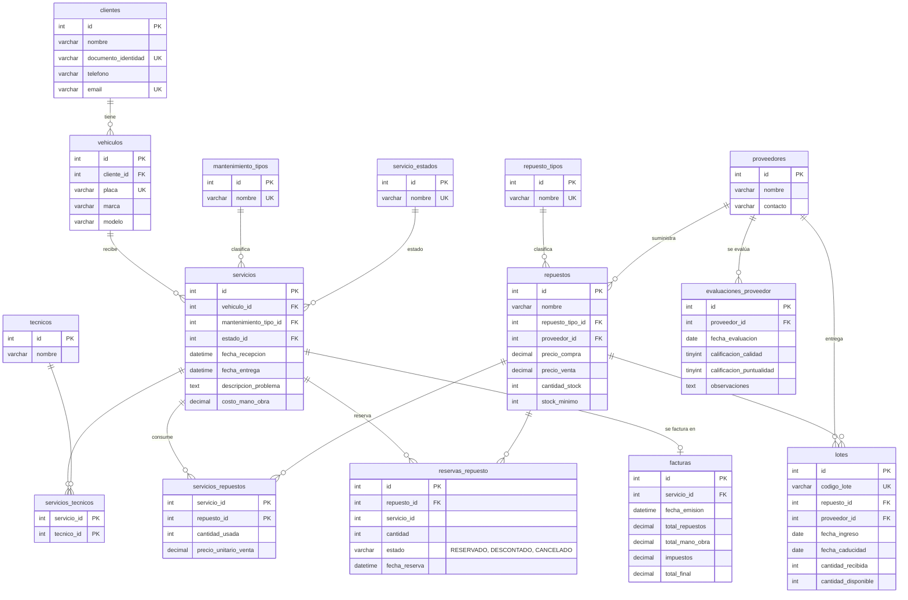
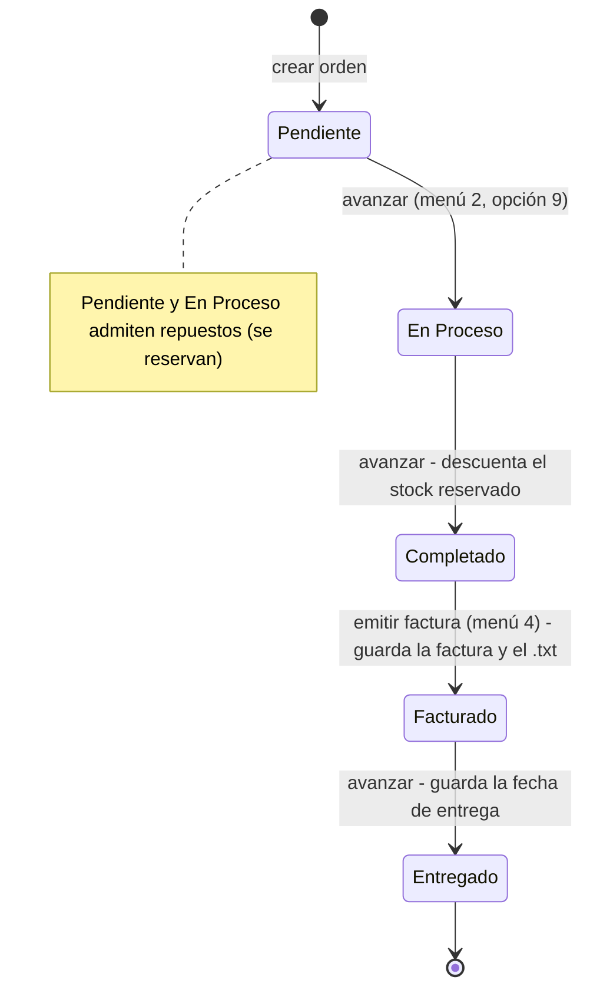
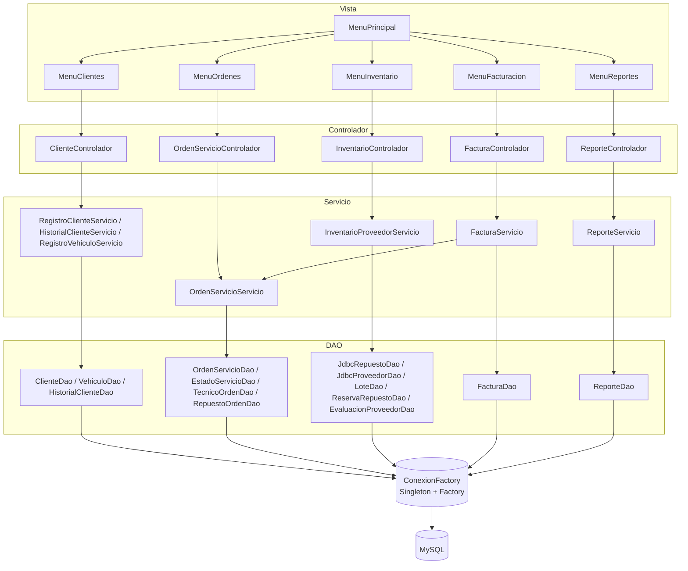
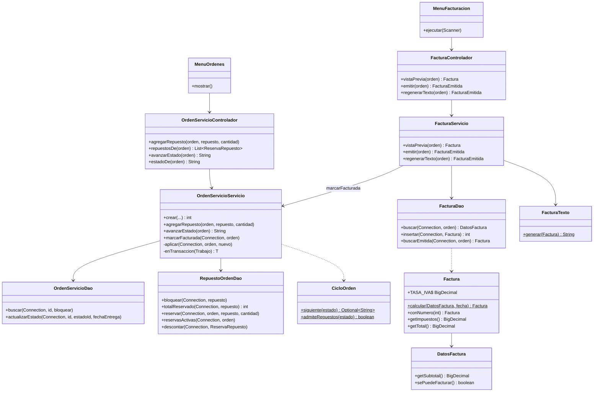

# Diagramas de CarMotors (proyecto integrado)

GitHub dibuja estos diagramas automáticamente. Para tener los `.png`, pega cada bloque en
<https://mermaid.live>, exporta la imagen y reemplaza `diagrama-er.png`, `diagrama-clases.png`
y `arquitectura.png` con el mismo nombre, para que los enlaces del README sigan funcionando.

## 1. Entidad-relación

## 2. Ciclo de estados de una orden

## 3. Arquitectura por capas (MVC + servicio + DAO)

## 4. Clases del ciclo de la orden y la facturación

